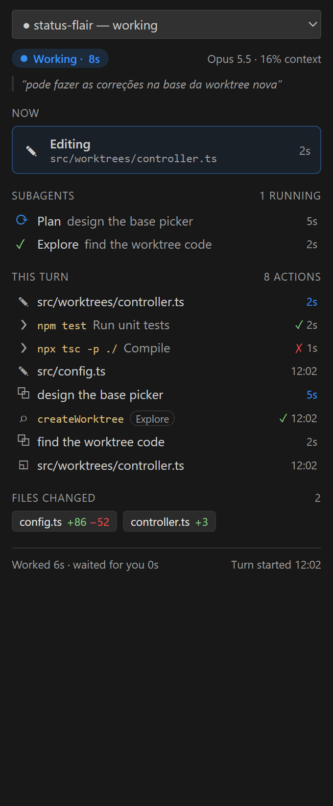

# Status Flair

[](https://marketplace.visualstudio.com/items?itemName=thiagobotelhonet.status-flair)
[](https://marketplace.visualstudio.com/items?itemName=thiagobotelhonet.status-flair)
[](LICENSE)

Status Flair puts your own item and colors in the VS Code status bar. If you work with Claude Code, it also shows what each session is doing, how much of your plan is left, and which agent finished in which git worktree.

> Status Flair is an independent project. It is not made by, affiliated with, or endorsed by Anthropic. "Claude" and "Claude Code" are trademarks of Anthropic, used here only to describe compatibility.



## Install

Search for "Status Flair" in the Extensions view, or run:

```bash
code --install-extension thiagobotelhonet.status-flair
```

You need VS Code 1.90 or later. Everything else is optional and only matters for the feature that uses it:

| Feature | Needs |
| --- | --- |
| Claude Code item, Lens, inbox | Claude Code, and Node.js on your PATH for the hooks |
| Worktrees | git |
| Pull request and CI status | The [GitHub CLI](https://cli.github.com), signed in |

## Features

### Your own status bar item

By default the item shows `$(flame) <your user name>`. You can change the text, icon, tooltip, side and position, and choose what a click does.

```jsonc
"statusFlair.item.text": "${user} on ${gitBranch}",
"statusFlair.item.icon": "$(heart)",          // a codicon, or an emoji like "🔥"
"statusFlair.item.tooltip": "Last check: ${time}",
"statusFlair.item.clickAction": "openUrl",    // none | openSettings | pickColor | openUrl | runCommand | openClaude
"statusFlair.item.clickValue": "https://github.com"
```

These variables work in any text or tooltip:

| Variable | Value |
| --- | --- |
| `${user}` | Your OS user name |
| `${workspaceName}` | Workspace name |
| `${folderName}` | Folder of the active file |
| `${gitBranch}` | Current git branch |
| `${worktreeName}` / `${worktreeCount}` | Current worktree and how many the repository has |
| `${prNumber}` / `${issueTitle}` | Pull request of the branch and the issue its name points to |
| `${time}` / `${date}` | Current time and date |
| `${claudeModel}` | Model of the latest Claude Code session in this workspace |
| `${claudeContext}` / `${claudeContextPercent}` | Its context size, like `49k`, and how full the window is, like `16%` |
| `${claudeState}` | `working`, `waiting for you`, `done` and so on |
| `${claudeUsage5h}` / `${claudeUsageWeek}` | Plan usage in the 5-hour and weekly windows, like `41%` |
| `${claudeCost}` | Session cost as Claude Code reports it, like `$4.12` |

For more items, add them to `statusFlair.extraItems`:

```jsonc
"statusFlair.extraItems": [
  { "icon": "$(book)", "text": "Docs", "url": "https://code.visualstudio.com/docs" },
  { "icon": "$(terminal)", "command": "workbench.action.terminal.new", "alignment": "right" }
]
```

### Status bar colors

Run **Status Flair: Pick Status Bar Color** and move through the presets; the bar previews each one as you go. You can also type a hex color or roll a random one. Random colors keep white text readable at a 4.5:1 contrast ratio.

If you only set `statusFlair.colors.background`, the rest is derived from it: a readable text color, and darker shades for "no folder", debugging and the remote indicator. You can set any of them yourself.

To give one project its own color, run **Status Flair: Pick Color for This Workspace**. The color goes to that project's `.vscode/settings.json`, which makes windows of different projects easy to tell apart. Set `statusFlair.colors.target` to `workspace` to make that the default.

Status Flair remembers what each color key held before it took it over and restores it when you remove the color or run **Status Flair: Reset Colors**. It writes to `settings.json` only when a value actually changes.

### Claude Code

When a Claude Code session runs in the open folder, a Claude item shows its model and context size, with an icon for its state: idle, working (spinning), waiting for your permission or answer (warning background), or just finished.

Hover it for the usage panel: the 5-hour and weekly plan limits with their reset times, the weekly limit per model, the context window, and the session's cost and tokens. The item turns amber when a limit passes `statusFlair.claude.usageWarningThreshold` (80% by default) or the context passes `contextWarningThreshold` (70%), and the panel then suggests `/compact`. After a few readings it also projects your pace, for example "At this pace it runs out Thu 3:00 PM".


Model and token counts come from Claude Code's local transcripts in `~/.claude/projects`, so they work right away. Plan limits come from your `/usage` reports and from Claude Code's [status line input](https://code.claude.com/docs/en/statusline); they are only reported for Pro and Max plans.

#### Connecting to Claude Code

Live state, the Lens and plan limits from the status line need a one-time setup: run **Status Flair: Connect to Claude Code**. You are also asked once on first run. It edits `~/.claude/settings.json` after saving a backup next to it, and adds:

- hooks that record each session's state and current activity, next to any hooks you already have;
- a status line recorder that saves `rate_limits`, `context_window` and `cost`. If you already have a status line, it keeps working: it gets the same input and its output is unchanged.

Both scripts print nothing, always exit successfully, and only write small files under `~/.claude/status-flair`, so they cannot change what Claude does. **Status Flair: Disconnect from Claude Code** removes them and puts your previous status line back exactly. If another tool replaces the status line later, Status Flair notices and offers to reconnect.

#### Every session in one place

With several sessions open across projects and worktrees, an inbox item counts them: `$(bell-dot) 1  $(check) 2  $(loading~spin) 3` means one is waiting for you, two finished and you have not looked yet, and three are working. Click it to see each session with the start of its prompt and how long Claude has worked and waited for you, then jump to its window.

You get a message when a session needs you or finishes, naming the project and worktree ("Claude finished · hub-preditivo / 048-operacao"), or a desktop notification when VS Code is in the background. Nothing shows when you are already looking at that session's window, and only one VS Code window notifies. `statusFlair.claude.notify` turns this down or off.

#### Claude Lens

A status bar item shows what Claude is doing right now, like `Editing controller.ts` or `Approve Bash: rm -rf dist`. Click it to open the Claude Lens panel. It updates live with the current action and a timer, the subagents that are running or done, this turn's timeline (commands with their result and duration, edits, searches, and calls made by subagents), and the files changed with their added and removed lines. The dropdown at the top switches between sessions on the machine.

The Lens also works when you use Claude Code from its VS Code extension, where Claude Code's own terminal plugins do not draw.

#### Optional

`statusFlair.claude.colorizeStatusBar` paints the whole bar blue while Claude works, amber while it waits and green when it finishes. It writes to the workspace settings, so each project window shows its own state.

### Git worktrees

In a git repository, a worktree item shows where you are, like `$(worktree) feat-login · 4`, with a bell when Claude is waiting for you in another worktree. Click it to switch:

```text
 Worktrees · hub-preditivo
 ─────────────────────────────────────────────────
 $(repo) hub-preditivo      developer · this window
 🔔 048-operacao            docs/048-regras  #60 merged   Claude waiting for you
 ⟳ 063-board-pr             ci/063-board     #64 open     Claude working · 2 changes
 ─────────────────────────────────────────────────
 + New worktree…
 ✦ New worktree with Claude…
 🗑 Clean up worktrees…
```

Enter opens the worktree in a new window. The buttons on each row open it in this window, copy its path, or delete it.

New worktree asks for a branch. An existing branch is checked out as is. A new one starts from an up-to-date shared base, by default the main worktree's branch on the remote (like `origin/developer`), and never from the worktree you happen to be in, so a new task does not inherit another task's commits and the agents working elsewhere are not touched. The branch button picks a different base. The worktree goes to `statusFlair.worktrees.location`, which defaults to Claude Code's `.claude/worktrees/<branch>`. Folders inside the repository are added to `.git/info/exclude`, which is local and never committed, and files listed in `statusFlair.worktrees.copyFiles` (like `.env`) are copied over.

Clean up worktrees fetches first, then lists the worktrees you can let go of. Worktrees whose branch or pull request was merged, whose remote branch was deleted, or whose folder no longer exists come pre-selected. Ones with no commits for `staleDays` are listed but not selected. The main worktree and the one in this window are never offered, and worktrees with uncommitted changes or an active Claude session are flagged and left unselected. Branches are only deleted if you confirm it in a second step.

`statusFlair.worktrees.autoColor` gives each worktree a stable color derived from its name. It only writes `.vscode/settings.json` where git ignores that file, and offers to ignore it locally.

### Pull requests and issues

With the GitHub CLI signed in, a pull request item shows the current branch's PR and its checks, like `$(git-pull-request) #62 $(check) $(pass)` for passing checks and an approved review. It turns red when a check fails. The tooltip lists failing checks with links, the review state, and the issue the branch name points to (`feat/056-…` points to issue #56). A click opens the PR, or offers to create one when the branch has none.

## Commands

| Command | What it does |
| --- | --- |
| Status Flair: Pick Status Bar Color | Presets with live preview, custom hex, random |
| Status Flair: Pick Color for This Workspace | The same, saved to this project only |
| Status Flair: Random Status Bar Color | Rolls a new color |
| Status Flair: Reset Colors | Removes every color Status Flair set and restores what was there |
| Status Flair: Connect to / Disconnect from Claude Code | Installs or removes the hooks and status line recorder |
| Status Flair: Go to Claude Session… | Lists every active session and jumps to its window |
| Status Flair: Show Claude Lens | Opens the Lens panel |
| Status Flair: Open Claude Code | Opens Claude Code |
| Status Flair: Open Pull Request | Opens the current branch's PR, or creates one |
| Status Flair: Switch Worktree… | Opens the worktree picker |
| Status Flair: New Worktree… | Creates a worktree and opens it |
| Status Flair: Clean Up Worktrees… | Deletes merged or abandoned worktrees after you confirm |
| Status Flair: Open Settings | Shows all Status Flair settings |

All settings live under `statusFlair.*`; search for "Status Flair" in the Settings editor to see them with their descriptions.

## Privacy

Status Flair has no telemetry and no servers. It reads Claude Code's local transcripts and the state files its own scripts write, and calls `git` and `gh` on your machine. The only network traffic is what those tools do on your behalf: `git fetch` before creating or cleaning up worktrees, and GitHub CLI requests for pull requests and issues. Desktop notifications on Windows go through PowerShell.

The files it writes outside your workspace are `~/.claude/settings.json` (only when you connect or disconnect, with a backup) and the small state files under `~/.claude/status-flair`.

## Uninstalling

VS Code gives extensions no chance to clean up when they are uninstalled. Before removing Status Flair, run **Status Flair: Reset Colors** and **Status Flair: Disconnect from Claude Code** so your settings and Claude Code configuration go back to how they were.

The scripts run with `node`, which must be on your PATH. If you use `CLAUDE_CONFIG_DIR`, Status Flair picks it up, or you can set `statusFlair.claude.configDir`.

## Contributing

Bug reports, ideas and pull requests are welcome. [CONTRIBUTING.md](CONTRIBUTING.md) explains how to build, test and debug the extension, and how the code is organized. Please read the [code of conduct](CODE_OF_CONDUCT.md) first, and report security issues privately as described in [SECURITY.md](SECURITY.md).

## License

[MIT](LICENSE)
